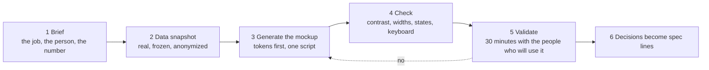

# Mockup first: from a brief to a validated decision

The fastest honest way to validate an idea is to show the people who will use it a screen that looks and behaves like the real thing, built on their own data, before any production code exists. This is the workflow, step by step. It takes days, not weeks, and it ends with decisions written as spec lines, not with a document nobody reads.

## 1. The brief

One page. The job the screen supports, in the words of the person who does it. Who they are and how often they open it. The number the product is meant to move. What the screen must never do. For an agent screen, the autonomy tier: does it suggest, propose, act with approval, or act alone? Template: [`templates/mockup-brief.md`](../templates/mockup-brief.md).

## 2. The data snapshot

Pull a real sample from the system the screen reads: the CRM, the ticket queue, the spreadsheet. Anonymize names and amounts with a reversible rule you keep private. Freeze it in a JSON file with the date of the snapshot. Everything relative on the screen ("overdue by 3 days") is computed from that date, so the mockup does not age. Invented data is the single largest cause of screens that pass review and fail in production.

## 3. Generate the mockup

Tokens first: colors, type scale, spacing, radii, shadows, in one file at the top of the generator. Then the components, then the views, then the shell and navigation. The output HTML is never edited by hand. A change is a change to the generator, regenerated and re-checked. Keep it to standard HTML, CSS and a little JavaScript, so it opens from a file and runs anywhere, and so a developer can read it as a specification.

What the mockup must include, even in version 1: the empty state, the loading state, one error, one success, and the main action from start to result. A happy-path-only mockup gets approved for a product that will spend half its life off the happy path.

## 4. Check

Run the measured checks at two widths and fix what fails. Run the visual tells list and fix the ones that apply. Run the five-second test with someone who has not seen the brief. Only then schedule the session.

## 5. The validation session

Thirty minutes, three to five people who will use the screen or decide about it, at least one of them not technical. Not a demo: a working session.

- Open on the job, not on the screen: "You just finished a meeting with a customer. Show me what you do next." Then show the screen doing that.
- Let them click. Watch where they hesitate. Do not explain; note.
- Ask five questions: What is this screen for? What would you do first? What is missing to do your job? What here would you not trust? What would you remove?
- For an agent screen, add: What did the agent do, and would you let it do that without asking you?
- Record every statement as one of three things: a decision (goes into the spec), an objection with its owner (goes into open questions), or a data gap (goes into the snapshot for the next round).

Template: [`templates/validation-session-notes.md`](../templates/validation-session-notes.md).

## 6. Decisions become spec lines

Each decision is written as a line a developer and a coding agent can build from: what the screen shows, what the person can do, what the system writes, what it must never do. The lines go into the Feature or the User Story, with a link to the mockup and the session date. The mockup stays as the visual reference and keeps being regenerated as the data and the decisions change. When the built product diverges from it, one of the two is wrong, and the session notes say which.

## Why this works for agentic systems too

An agent product has more to validate, not less: whether people understand what the agent did, whether they trust its proposal enough to approve it, and whether the trail is readable afterwards. A mockup with real records, a real proposal and an approval button answers all three in one session. The backlog method that takes the decisions from here is [backlog-writing-system](https://github.com/Benyoumen/backlog-writing-system); the UX rules for the agent's presence, proposals and trail are in [agent-design-principles](https://github.com/Benyoumen/agent-design-principles).
